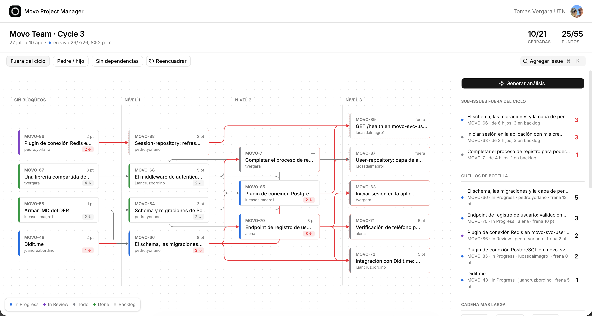

# Movo PM

Herramienta para la planificación de equipos que usan Linear: una lente sobre el ciclo activo (bloqueos, cadena crítica, sub-issues varadas, análisis asistido por Claude), con edición puntual de assignee, status y ciclo desde el panel lateral. Linear sigue siendo la fuente de verdad.

Ver `movo-pm-preplan.md` para el dominio completo y `docs/mockup.html` para la referencia de interfaz.

## Varios workspaces de Linear

La app admite invitados por workspace. Cada invitado entra con GitHub usando el correo principal verificado de esa cuenta; no necesita pertenecer a la organización GitHub de Movo. `ADMIN_GITHUB_IDS` contiene los IDs numéricos de GitHub de los administradores globales. Es obligatorio configurar al menos uno antes de abrir el acceso a invitados.

Para conectar Linear, creá una aplicación OAuth **pública** (instalable en otros workspaces) con callback `https://TU_DOMINIO/api/linear/callback`, habilitá webhooks de cambios para issues y ciclos y configurá las variables `LINEAR_OAUTH_CLIENT_ID`, `LINEAR_OAUTH_CLIENT_SECRET`, `LINEAR_OAUTH_WEBHOOK_SECRET` y `LINEAR_TOKEN_ENCRYPTION_KEY`. En local registrá además `http://localhost:3000/api/linear/callback` como callback permitido. Generá la última variable con 32 bytes aleatorios en base64 y mantenela estable: cambiarla impide descifrar los tokens guardados. La conexión solicita `read,write` con `actor=app`; en Linear los cambios figuran como hechos por la aplicación. La herramienta registra el correo del operador en `linear_audit`.

Aplicá las migraciones con `npm run db:migrate`. La migración 0003 conserva los snapshots y hojas de Movo, asigna a sus usuarios actuales al workspace inicial y permite seguir usando `LINEAR_API_KEY` mientras se autoriza Movo por OAuth. Después de conectar el workspace, habilitá sus equipos e invitá usuarios desde **Configuración → Workspaces e invitados**. Configurá el webhook OAuth con la URL `https://TU_DOMINIO/api/webhooks/linear`; el webhook anterior de Movo puede permanecer activo durante la transición.
